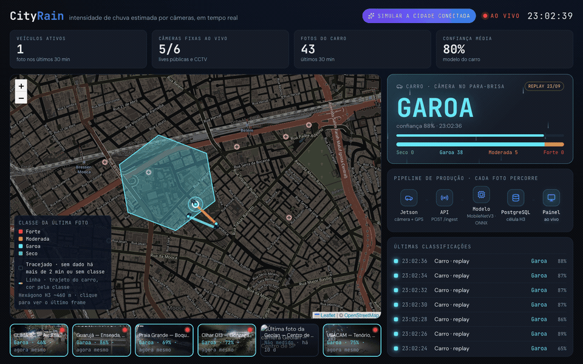
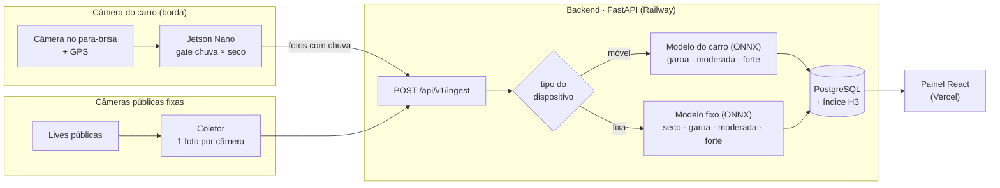
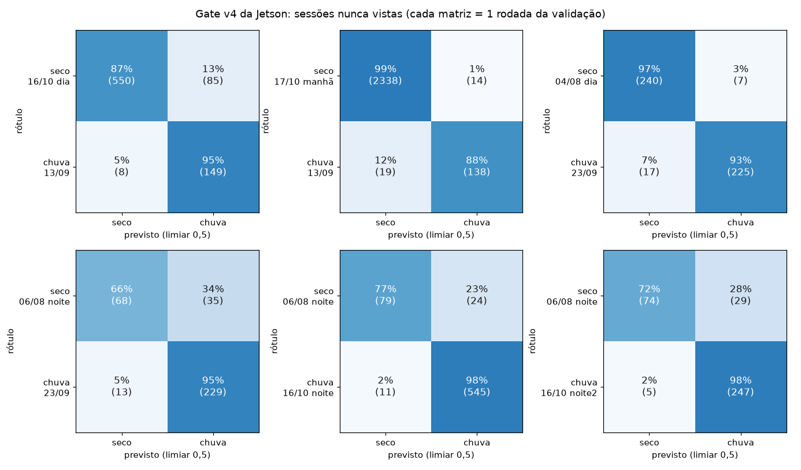
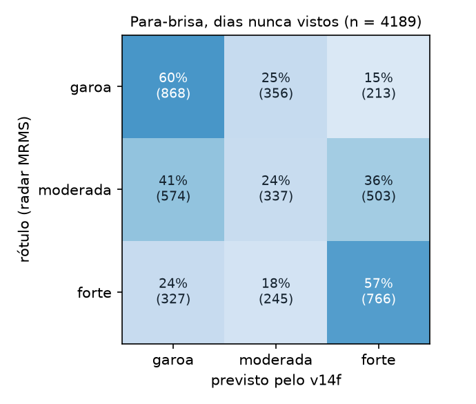
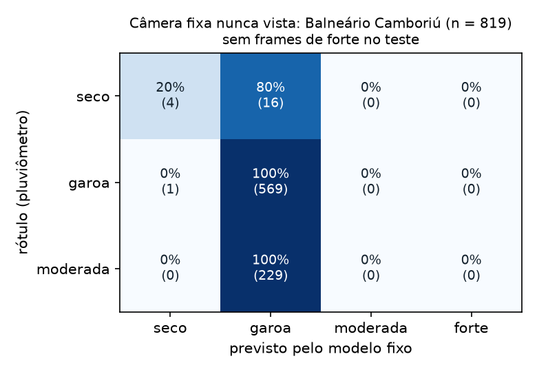
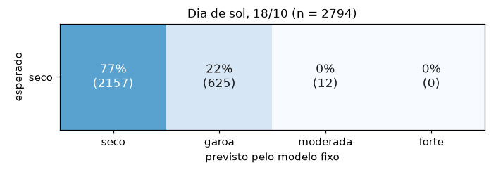

<p align="center">
  <picture>
    <source media="(prefers-color-scheme: dark)" srcset="docs/assets/logo-escuro.svg">
    
  </picture>
</p>

**Intensidade de chuva medida por câmeras, rua a rua.** Câmeras que já existem (no para-brisa de carros, em lives públicas e CCTV) estimam a intensidade da chuva em quatro níveis, e o resultado aparece ao vivo num mapa hexagonal da cidade.

[](https://github.com/Rodrigomt21/CityRain/actions/workflows/ci.yml)




| | |
|---|---|
| **Painel ao vivo** | https://cityrain.vercel.app · modo apresentação em [`/apresentacao`](https://cityrain.vercel.app/apresentacao) |
| **API (OpenAPI)** | https://api-production-046f.up.railway.app/docs |
| **Trabalho** | TCC de Ciência da Computação, Instituto Mauá de Tecnologia (IMT), 2026 |

---

## O problema e a proposta

São Paulo tem 110 estações públicas de chuva (79 pluviômetros do CEMADEN, 29 da CGE e 2 do INMET) para 1.522 km²: uma a cada 14 km². Dos 2.047 hexágonos de ~460 m que cobrem a cidade, só 106 (5%) têm uma estação dentro, e 45% da cidade fica a mais de 2 km da mais próxima. (A CGE lista 32 postos, mas 3 ficam fora da capital; ela não publica coordenadas, então as posições da CGE são aproximadas pelo bairro.) Uma chuva forte num bairro pode não aparecer em nenhuma estação. O CityRain transforma câmeras em sensores. Cada imagem vira uma classe de intensidade, com posição e horário, agregada numa grade de hexágonos H3 de ~460 m.

| Classe | Faixa (mm/h) |
|---|---|
| `seco` | 0 |
| `garoa` | até 2,5 |
| `moderada` | 2,5 a 10 |
| `forte` | acima de 10 |

- **O modelo vê só a imagem.** Pluviômetros (CEMADEN) e radar meteorológico (NOAA MRMS) servem apenas para **rotular o treino** e **avaliar**. Em produção nenhuma estação é consultada.
- **Dois tipos de câmera, dois modelos**, cada um treinado e avaliado no próprio domínio:
  - **Carro:** a Jetson Nano roda um *gate* chuva × seco e descarta o seco na placa; a foto com chuva vai ao backend, que estima a intensidade.
  - **Câmeras fixas:** um coletor lê lives públicas e envia uma foto por câmera a cada 1 a 10 min; o backend classifica com um modelo próprio de 4 classes.

## Arquitetura



## Resultados

Protocolo, intervalos de confiança e todos os experimentos em [`docs/resultados-experimentos.md`](docs/resultados-experimentos.md). Teste é sempre com dado real, em dias, sessões ou câmeras que o modelo não viu no treino.

O sistema usa **três modelos**:

| Modelo | Onde roda | Tarefa | Rótulo do teste |
|---|---|---|---|
| [Gate v4](#1-gate-da-jetson-chuva--seco) | Jetson Nano, no carro | chuva × seco | visual (gota no vidro), por sessão |
| [Intensidade do carro v14f](#2-intensidade-do-carro-v14f) | backend | garoa · moderada · forte | radar MRMS e pluviômetro CEMADEN |
| [Câmera fixa](#3-câmera-fixa) | backend | seco · garoa · moderada · forte | pluviômetro |

As matrizes abaixo mostram, em cada linha, para onde vão as imagens de uma classe real: a diagonal é acerto. Gerar de novo: `ml/scripts/avaliacao/matrizes_confusao.py` (as do v14f vêm das predições salvas da validação cruzada).

### 1. Gate da Jetson (chuva × seco)

MobileNetV2 384×384, decide na placa se a foto vai para o backend. Validação deixando uma sessão seca e uma de chuva fora do treino em cada rodada (`ml/resultados/gate_v4_cv.json`), limiar 0,5:

- **Seco de dia:** alarme falso de **1–13%** (gate v3: 33–41%).
- **Chuva:** recall de **88–98%**.
- **Seco à noite:** alarme falso de **23–34%**. Só há uma sessão seca noturna (06/08); é o ponto fraco do gate.



As duas sessões de chuva noturna são da mesma noite (uma fica no treino quando a outra é teste), então o recall de 98% à noite é otimista.

### 2. Intensidade do carro (v14f)

**Modelo do carro em produção: v14f** (MobileNetV3-Large, 288×384, sem dado sintético, só de dia). Treinado com sessões do carro, irCNN, ~400 vídeos do BDD100K e **20 dias de chuva real vista de dentro de carros** (dashcams do YouTube e Mapillary), rotulados pelo radar MRMS.

| Teste (nenhum visto no treino) | v7 (anterior) | **v14f** |
|---|---|---|
| Para-brisa em dias, câmeras e cidades nunca vistos (F1 macro) | 0,167 | **0,457** |
| Temporal de SP 10/03/2023 (CEMADEN 35–87 mm/h): frames forte | 0% | **13%** |
| Temporal de SP: frames moderada ou mais | 64% | 59% |
| Vídeos de temporal: pico classificado acima do início | 0,705 | **0,931** |
| Garoa do nosso carro em sessão nunca vista | 100% | 98,7% |

**Referências no mesmo teste de para-brisa** (4.189 frames de 20 dias: 1.437 garoa, 1.414 moderada, 1.338 forte): responder sempre a classe majoritária (garoa) dá F1 macro **0,170**; sortear a classe na proporção do teste dá **0,333** (1.000 sorteios, IC 95% 0,320–0,347). O v7 estava no nível da classe majoritária; o v14f fica acima do sorteio. Valores e matriz de confusão calculados a partir das predições salvas da validação cruzada ([`docs/assets/baselines-v14f-parabrisa.json`](docs/assets/baselines-v14f-parabrisa.json)).



**Chuva forte:** no temporal de SP o modelo subestima a intensidade: o CEMADEN marcou 35 a 87 mm/h, mas só 13% dos frames saíram como forte (59% como moderada ou forte). O forte de para-brisa do treino vem de dashcams e do Mapillary nos EUA, rotulados pelo radar MRMS; não há chuva forte de para-brisa rotulada em SP. E o vídeo do temporal não tem a hora exata de cada trecho, por isso ele mede só a fração de frames ≥ moderada, sem rótulo por frame.

### 3. Câmera fixa

Modelo do Mattioli em produção (`loco_bc_atlantica_f2ord`): EfficientNet-B0 com perda ordinal, treinado só com chuva real medida por pluviômetro e **sem** a câmera de teste.

- **Câmera nunca vista** (Balneário Camboriú, 819 fotos): 70% de acerto e F1 macro 0,381 (modelo anterior: 69% e 0,294). **A matriz mostra o limite:** o modelo responde garoa para praticamente tudo. Todas as 229 fotos de moderada saem garoa, e responder sempre garoa daria 69,6% de acerto. Numa câmera nova, ele ainda não separa a intensidade.
- **Dia de sol** (18/10, 2.794 fotos das câmeras de produção): **77% classificadas como seco** (anterior: 36%). É o ganho real deste modelo: separar seco de chuva.





O teste de Balneário Camboriú não tem foto de chuva forte. As câmeras do painel entraram no treino, então ao vivo elas mostram o melhor caso do modelo. Medido com `ml/scripts/avaliacao/checar_modelo_fixa.py`.

### Borda

Jetson Nano com CUDA: gate a 11 FPS e intensidade a 14 FPS, contra captura a 1 fps. FP16 sem perda (8,4 MB).

## Demonstração

- **[`/apresentacao`](https://cityrain.vercel.app/apresentacao):** tela cheia com o carro andando no mapa, a classe atual, o pipeline de produção acendendo a cada foto e as câmeras fixas ao vivo.
- **[`/simulacao`](https://cityrain.vercel.app/simulacao):** simulação **ilustrativa** de uma frota de carros e câmeras cobrindo São Paulo, com chuva por bairro e alerta de chuva forte. Nada vai para a API.
- Roteiro completo, incluindo o replay da sessão de chuva de 23/09 pelo Mac: [`docs/roteiro-demo-defesa.md`](docs/roteiro-demo-defesa.md).

## Estrutura do repositório

```
CityRain/
├── backend/    API FastAPI, inferência ONNX, PostgreSQL + H3, Alembic        → backend/README.md
├── frontend/   Painel React 19 + Vite + Tailwind + Leaflet + h3-js           → frontend/README.md
├── ml/         Coleta, rotulagem, treino, avaliação, exportação ONNX, Jetson  → ml/README.md
└── docs/       Resultados, guias da equipe, specs e roteiro da defesa        → docs/README.md
```

Mapa detalhado do código: [`docs/CODEBASE_MAP.md`](docs/CODEBASE_MAP.md).

## Como rodar

```bash
# backend (Python 3.11)
cd backend && python3.11 -m venv .venv && source .venv/bin/activate
pip install -r requirements.txt -r requirements-dev.txt
cp .env.example .env && alembic upgrade head && uvicorn app.main:app --reload

# frontend
cd frontend && npm ci && VITE_API_URL=http://localhost:8000 npm run dev

# ml
python3 -m venv ml/.venv && ml/.venv/bin/pip install -r ml/requirements-treino.txt
```

**Testes:** `pytest` em `backend/` (integração com `TEST_DATABASE_URL`) e em `ml/tests/`; `npx vitest run` em `frontend/`. O CI roda os três a cada push e PR.

Dados (imagens, splits e runs) ficam fora do Git; os manifests de rótulo e os resumos de resultado são versionados.

## Segurança e privacidade

- Um token por dispositivo, guardado só como hash; chave de admin para cadastro; comparação em tempo constante.
- Upload validado pelo conteúdo (JPEG/PNG), com teto de tamanho; nome e extensão do arquivo nunca vêm do cliente.
- **Foto do carro nunca é exibida** (só classe e posição); fotos de câmera fixa são apagadas depois de 60 min.
- Segredos (`.env`, tokens) fora do Git; histórico verificado em 18/10/2026. Detalhes em [`SECURITY.md`](SECURITY.md).

## Limitações conhecidas

- No para-brisa, a generalização para dias e câmeras nunca vistos ainda é limitada (F1 0,457); a moderada é a classe mais difícil.
- Numa câmera fixa que não entrou no treino, o modelo responde garoa para quase tudo: nenhuma das 229 fotos de moderada de Balneário Camboriú foi reconhecida.
- O modelo da câmera fixa ainda marca como garoa parte das fotos secas, sobretudo à noite (46% das fotos de 18/10 à noite saíram como seco).
- Garoa em câmera fixa é quase invisível (F1 ≤ 0,06 no irCNN).
- O modelo do carro é só de dia; o gate erra mais à noite.
- O forte de para-brisa rotulado vem dos EUA (radar MRMS); em SP o único teste de temporal não tem hora exata por frame.

## Equipe

| Nome | Frente |
|---|---|
| Rodrigo Monteiro Toffoli Teixeira | Modelo do carro (gate e intensidade) |
| Guilherme Mattioli | Modelo da câmera fixa |
| Gabriel Moreno | Backend, coleta no carro |
| Paulo Vespero | Frontend |

**Orientador:** Prof. Gabriel de Souza Lima · Centro Universitário do Instituto Mauá de Tecnologia (IMT)

## Como citar

```bibtex
@thesis{cityrain2026,
  title   = {CityRain: Sistema Embarcado de Monitoramento Climático Urbano por Visão Computacional},
  author  = {Teixeira, Rodrigo M. T. and Mattioli, Guilherme and Moreno, Gabriel and Vespero, Paulo},
  school  = {Centro Universitário do Instituto Mauá de Tecnologia},
  year    = {2026},
  advisor = {Lima, Gabriel de Souza}
}
```

## Licença

Código sob a licença [MIT](LICENSE). Datasets de terceiros (irCNN, BDD100K, Mapillary e outros) seguem as licenças originais e não são redistribuídos neste repositório.
