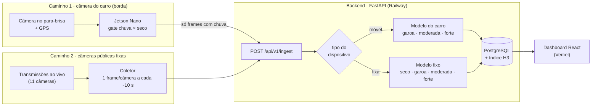

# CityRain

**Monitoramento de chuva urbana por visão computacional.** Câmeras comuns (uma câmera no carro e câmeras públicas fixas) classificam a intensidade da chuva em quatro níveis, e o resultado aparece em tempo real em um mapa da cidade.

[](https://github.com/Rodrigomt21/CityRain/actions/workflows/ci.yml)


| | |
|---|---|
| **Dashboard ao vivo** | https://cityrain.vercel.app |
| **API (OpenAPI)** | https://api-production-046f.up.railway.app/docs |
| **Trabalho** | TCC de Ciência da Computação, Instituto Mauá de Tecnologia (IMT), 2026 |

---

## O que o sistema faz

| Classe | Faixa (mm/h) | No mapa |
|---|---|---|
| `seco` | 0 | verde, raio ~1 km |
| `garoa` | até 2,5 | ciano, raio ~1 km |
| `moderada` | 2,5 a 10 | laranja, raio ~600 m |
| `forte` | acima de 10 | vermelho, raio ~300 m |

- **O modelo vê só a imagem.** Pluviômetros públicos (CEMADEN, INMET, CGE-SP) são usados apenas para **rotular o treino** e **avaliar** o modelo. Em produção não há consulta a estação.
- **Dois tipos de câmera, dois modelos**, cada um treinado e avaliado no próprio domínio:
  - **Carro:** a Jetson Nano roda um *gate* que decide chuva × seco e descarta o seco ali mesmo. O frame com chuva vai ao backend, que estima a intensidade.
  - **Câmeras públicas fixas:** não há hardware nosso. Um coletor lê as transmissões ao vivo e envia um frame por câmera a cada ~10 s, e o backend classifica com um modelo próprio de 4 classes, treinado só com imagens dessas câmeras rotuladas por pluviômetro.
- **Mapa ao vivo:** cada câmera aparece com um círculo na cor da última classe. O raio encolhe com a intensidade, porque chuva forte é localizada. Sem dado recente (mais de 2 min), a câmera fica cinza e o círculo não aparece. O histórico é agregado em células hexagonais **H3**.

## Arquitetura

Dois caminhos independentes até o mesmo banco. Só o carro tem processamento de borda; as câmeras públicas são lidas por um coletor e classificadas no servidor.



**Treino (offline, em `ml/`), um conjunto de dados por modelo. Nenhuma estação é consultada em produção.** A v3 em produção ainda usa dado sintético no treino; a próxima versão sai sem sintético.

| Modelo | Treino | Rótulo | Teste principal |
|---|---|---|---|
| Gate (Jetson) | sessões do carro + seco de maio | visual: vidro com ou sem gota | sessão do carro nunca vista |
| Intensidade do carro | sessões do carro + irCNN (+ BDD100K, em teste) | pluviômetro (CEMADEN); radar MRMS no BDD100K | sessão do carro nunca vista + irCNN por evento |
| Intensidade fixa | lives públicas + irCNN | pluviômetro (CEMADEN) a ≤ 5 km | câmera nunca vista + teste prospectivo |

## Resultados

Protocolo completo, intervalos de confiança e todos os experimentos em [`docs/resultados-experimentos.md`](docs/resultados-experimentos.md). O teste é sempre com dado real; dado sintético entra só no treino.

**Intensidade, modelo do carro (v3 em produção):** MobileNetV3-Large, 288×384, validação cruzada por evento no irCNN (12 eventos de chuva com pluviômetro).

| Métrica | v3 | v6 (sem sintético) |
|---|---|---|
| F1 macro irCNN | **0,462** [0,401; 0,507] | 0,419 |
| F1 `forte` irCNN | **0,817** | 0,767 |
| Spearman score × mm/h | **0,64** | 0,45 |
| Garoa real do carro (sessão nunca vista) | 0,99 | 1,00 |

A v6 mostra que tirar o sintético piora o modelo: diferença pareada +0,045 [+0,014; +0,082].

**Gate da Jetson (chuva × seco), avaliado em sessão nunca vista:**

| | Chuva que passa | Alarme falso, seco de dia | Alarme falso, seco de noite |
|---|---|---|---|
| Original | 10–36% | — | 17% |
| **Gate v3** (com seco de maio) | **83–100%** | **4–11%** | 23–25% |

**Borda (Jetson Nano, CUDA):** gate 11 FPS e intensidade 14 FPS, contra captura a 1 fps. FP16 sem perda (8,4 MB).

**Câmera fixa:** modelo próprio de 4 classes, treinado só com dado real (lives rotuladas por CEMADEN + irCNN). Treino final e teste prospectivo em andamento até 20/10/2026.

## Estrutura do repositório

```
CityRain/
├── backend/    API FastAPI, inferência ONNX, PostgreSQL + H3, Alembic
├── frontend/   Dashboard React 19 + Vite + Tailwind + Leaflet
├── ml/         Rotulagem, treino, avaliação, exportação ONNX
│   ├── scripts/captura/      código que roda na Jetson
│   ├── scripts/coleta_fixa/  coletor das câmeras fixas e DVR das lives
│   ├── scripts/sessao_carro/ sessão do carro → frames rotulados
│   └── configs/              1 YAML = 1 experimento reproduzível
└── docs/       Resultados, guias da equipe, specs e roteiro da demo
```

Mapa detalhado do código: [`docs/CODEBASE_MAP.md`](docs/CODEBASE_MAP.md).

## Como rodar

**Backend** (Python 3.11; o SQLAlchemy fixado não funciona em 3.14):

```bash
cd backend
python3.11 -m venv .venv && source .venv/bin/activate
pip install -r requirements.txt
cp .env.example .env            # DATABASE_URL e ADMIN_KEY
alembic upgrade head
uvicorn app.main:app --reload   # http://localhost:8000/docs
```

**Frontend:**

```bash
cd frontend
npm install
VITE_API_URL=http://localhost:8000 npm run dev   # sem a variável, usa a API de produção
```

**ML** (treino e avaliação):

```bash
python3 -m venv ml/.venv && ml/.venv/bin/pip install -r ml/requirements-treino.txt
ml/.venv/bin/python ml/scripts/treino/treinar_intensidade.py ml/configs/treino_intensidade_cv_v3_mnv3.yaml --cv
ml/.venv/bin/python ml/scripts/treino/rodar_experimentos_fixa.py checar   # modelo da câmera fixa
```

**Testes:** `pytest` em `backend/` e `ml/tests/`; `npx vitest run` em `frontend/`. O CI roda os três a cada push.

Dados (imagens, splits e runs) ficam fora do Git. Veja [`docs/GUIA-TREINO-EQUIPE.md`](docs/GUIA-TREINO-EQUIPE.md).

## Guias

| Para | Documento |
|---|---|
| Sair com o carro e transformar a sessão em dado rotulado | [`docs/GUIA-SESSAO-CARRO.md`](docs/GUIA-SESSAO-CARRO.md) |
| Coletar as câmeras fixas e colher o DVR das lives | [`docs/GUIA-COLETA-EQUIPE.md`](docs/GUIA-COLETA-EQUIPE.md) |
| Treinar o modelo da câmera fixa | [`docs/GUIA-TREINO-EQUIPE.md`](docs/GUIA-TREINO-EQUIPE.md) |
| Apresentar a demo | [`docs/roteiro-demo-defesa.md`](docs/roteiro-demo-defesa.md) |

## Limitações conhecidas

- Moderada e forte reais **no para-brisa do carro** ainda não têm rótulo de pluviômetro. As classes altas do carro são avaliadas no irCNN (câmera fixa com pluviômetro).
- Garoa no irCNN é quase invisível (~1 mm/h em CCTV): F1 de garoa ~0,05 nesse domínio.
- O gate ainda tem alarme falso alto à noite (23–25%), porque faltam sessões secas noturnas do carro.

## Equipe

| Nome | RA | Frente |
|---|---|---|
| Rodrigo Monteiro Toffoli Teixeira | 23.00068-6 | Modelo do carro (gate e intensidade) |
| Guilherme Mattioli | 20.00599-7 | Modelo da câmera fixa |
| Gabriel Moreno | 23.01528-4 | Backend, coleta no carro |
| Paulo Vespero | 23.00607-2 | Frontend |

**Orientador:** Prof. Gabriel de Souza Lima · Centro Universitário do Instituto Mauá de Tecnologia (IMT)

## Como citar

```bibtex
@thesis{cityrain2026,
  title   = {CityRain: Sistema Embarcado de Monitoramento Climático Urbano por Visão Computacional},
  author  = {Teixeira, Rodrigo M. T. and Mattioli, Guilherme and Moreno, Gabriel and Vespero, Paulo},
  school  = {Centro Universitário do Instituto Mauá de Tecnologia},
  year    = {2026},
  advisor = {Lima, Gabriel de Souza}
}
```

## Licença

Código sob a licença [MIT](LICENSE). Datasets de terceiros (irCNN, BDD100K e outros) seguem as licenças originais e não são redistribuídos neste repositório.
